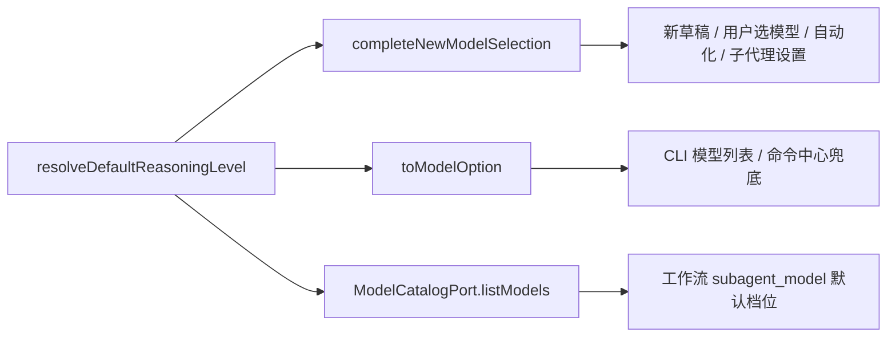
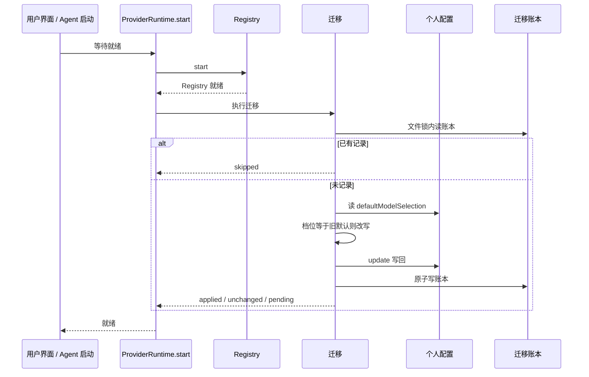

# Fen Jue 行为差异清单

> 登记 Fen Jue 相对上游（`zai-org/ZCode`）的有意行为差异。每条写明上游位置、Fen Jue 规则、所有者与复核方式；每次上游同步后逐项复核仍然生效（见根 `AGENTS.md`「Fen Jue 二开与上游同步」）。
>
> 产品身份与数据根的差异见 [Fen Jue 产品身份](../desktop/fen-jue-product-identity.md)；内置供应商配置的专项层见 [package-overrides.md](./package-overrides.md)。

| 编号 | 行为                     | 上游                       | Fen Jue            |
| ---- | ------------------------ | -------------------------- | ------------------ |
| D1   | 新模型选择的默认思考档位 | 取档位表最后一项（最高档） | 取最低的开启档     |
| D2   | 已保存默认选择的档位     | 不迁移                     | 首次启动一次性迁移 |

## D1 默认档位取最低开启档

### 产品规则

- 用户主动选模型、全新初始化、CLI 模型列表、工具层模型目录给出的默认档位，一律取**最低的开启档**。
- 开启档是档位表中不属于关闭档的项。关闭档按 Built-in 现行词汇表登记为 `disabled`、`none`；`minimal` 是开启档。
- 没有专门规则的模型档位表是 `disabled / enabled`，默认落到 `enabled`。全是关闭档时取首项，保证一定有默认值。
- 辅助调用（标题、压缩、连通性测试）沿用上游的首档规则，不在本条范围。
- 发给模型的说明文字必须与实际默认一致。闲时任务工具 `OffPeakCreate` 的说明与 `thoughtLevel` 入参描述已改为「省略即用模型默认档位（最低开启档）」；上游写的是「最高档」，照原样留着会让模型以为不设档位就是最高强度。
- 对本仓库构建的所有包生效，不按 flavor 区分：fork 只交付 Fen Jue，按 flavor 分叉只会给领域层引入产品身份依赖。

### 所有者与接口

规则函数 `resolveDefaultReasoningLevel(values)` 由 `@zcode/provider` 唯一持有（`packages/provider/src/model-selection-config.ts`）。三处默认值来源都必须调用它，任何一处自行取值都会重现「picker 默认一档、工具层默认另一档」的偏差：

| 来源                                                | 位置                                                                       | 影响面                                   |
| --------------------------------------------------- | -------------------------------------------------------------------------- | ---------------------------------------- |
| `completeNewModelSelection`                         | `packages/provider/src/model-selection-config.ts`                          | 新草稿、用户选模型、自动化、子代理设置   |
| `toModelOption`（`reasoning.defaultLevel`）         | `apps/zcode-cli/packages/bootstrap/src/app/provider-registry-selection.ts` | CLI 模型列表、命令中心兜底               |
| `createModelCatalogPort`（`defaultReasoningLevel`） | `apps/zcode-cli/packages/bootstrap/src/app/model-catalog-port.ts`          | 工作流 `subagent_model` 不写档位时的默认 |

### 验收

- `[disabled, enabled]` → enabled；`[none, low, medium, high]` → low；`[minimal, low, medium]` → minimal；`[disabled, none]` → disabled。
- 三处来源对同一份档位表给出同一个默认值。
- 真实内置配置里出现过的档位名都在已知词表内；上游新增关闭档的同义词时守护用例失败。
- 闲时任务工具说明与入参描述不再声称默认是最高档。

## D2 已保存默认选择的一次性迁移

### 产品规则

- 只处理个人配置里的 `defaultModelSelection`。已创建的会话、子代理的模型档位不迁移。
- 仅当已保存档位等于该模型档位表的最后一项（旧默认）时，改为 `resolveDefaultReasoningLevel(values)`；其余档位视为用户显式选择，不动。
- 一次性：以迁移账本 `fenjue-migrations.json`（与 `provider_config.json` 同目录）记录。账本已有记录则不再评估，因此迁移后手动调回最高档不会被下次启动改回。
- 解析不到模型（供应商已删除、档位表缺失）时不改也不记账，下次启动再试；没有默认选择时直接记账。
- 只由持有个人配置的 Services 进程执行；CLI Worker 不跑。

### 所有者与事件顺序

- 规则实现：`packages/provider-node/src/fenjue-default-reasoning-level-migration.ts`。写回只经个人配置的唯一写入口 `NodePersonalProviderConfigRepository.update()`，不另开写路径。
- 触发：`ProviderRuntime.start()` 在 Registry 就绪之后执行，先于任何模型选择视图读取与 Agent 启动。模型选择视图与供应商设置读取前都会等待该 `start()`，所以不存在「先读到旧默认、后迁移」的窗口。
- 并发：账本文件锁包住「读账本 → 评估 → 写回 → 写账本」。写回发生在个人配置锁内，并重新核对默认选择未被其他写入者改动；被改动则本轮放弃。
- 失败：记 warn 日志，不阻断启动；下次启动重试。

### 验收

- 最高档被改写为最低开启档并记账；第二次运行返回 skipped。
- 迁移后手动设回最高档，再次运行不改写。
- 档位不是最高档的不动，但记账。
- 解析不到模型时不改写也不记账；没有默认选择时只记账。
- 用真实的 `NodePersonalProviderConfigRepository` 走一遍写回，读回的默认档位是新值。

## 验证记录

### 2026-11-28 检查点 A（macOS，改动停留在工作区，未安装）

- 新增 `apps/zcode-cli/packages/bootstrap/tests/fenjue-default-reasoning-level.test.ts`，17 项通过：默认档位规则、三处来源一致、词表守护（真实内置配置的档位名全部在已知词表内）、迁移的各场景（含用真实个人配置仓库写回）。
- 按新规则更新的上游用例：`model-catalog-port.test.ts`、`provider-registry-app-runtime.test.ts`、`runtime-unbound-config.test.ts`，连同 `provider-registry-selection.test.ts` 与新增用例共 47 项通过。
- 闲时任务相关：bootstrap 64 项、contracts 7 项、core 26 项通过。
- bootstrap 全量 284 个文件：3869 项通过，8 项超时，18 项断言失败。其中 17 项与未改动基线逐条一致（`plugins-protocol` 12、`mcp-settings-workspace-switch` 2、`plugin-secrets` 1、`dynamic-mcp-config` 1、`visualize-skill-gate` 1），属既有失败，本次未处理。另 1 项是 `workflow-fault-matrix.retry` 的请求数偏差，该文件单独运行 13/13 通过，属负载相关的抖动。
- `pnpm typecheck` 通过。CLI 的 contracts、core、bootstrap、provider-node 四个包 `tsc --noEmit` 通过；CLI 根入口 `typecheck` 依赖 turbo，本机未安装，未运行。
- `pnpm lint` 0 错误，1462 条警告与改动前一致；CLI lint 0 错误。
- `pnpm architecture:check --changed` 0 违规。`architecture-policy.yaml` 新增 2 条登记：迁移模块（新文件）与 `model-catalog-port.ts`（存量准入文件被编辑）。
- 改动文件 `oxfmt --check` 通过。全仓 `fmt:check` 有 1583 个文件不合规，是仓库既有状态，与本次无关。
- 未验证：实机效果（新会话默认档位、已保存默认选择的迁移）要等整包安装；Windows 端未构建。

### 2026-11-28 实机安装（macOS，检查点 A 与 B 一并整包安装）

- 新版 Host 启动时执行了一次性迁移：日志为 `Fen Jue 默认思考档位迁移完成 {"result":"unchanged"}`，账本 `fenjue-migrations.json` 记下了 `default-reasoning-level-lowest`。本机的个人配置里没有保存过默认模型选择，所以没有东西可改写；「最高档被改写为最低开启档」这条路径在实机上没有真实数据可验证。
- 运行中的配置快照里，GLM-5.4 与 GLM-5.3-Flash 的档位表是 `low / high / max`，按 D1 新选这两个模型的默认档是 `low`。
- 未验证：新会话在界面上的默认档位。重启后还没有新建会话，应用也不是带调试端口启动的。
