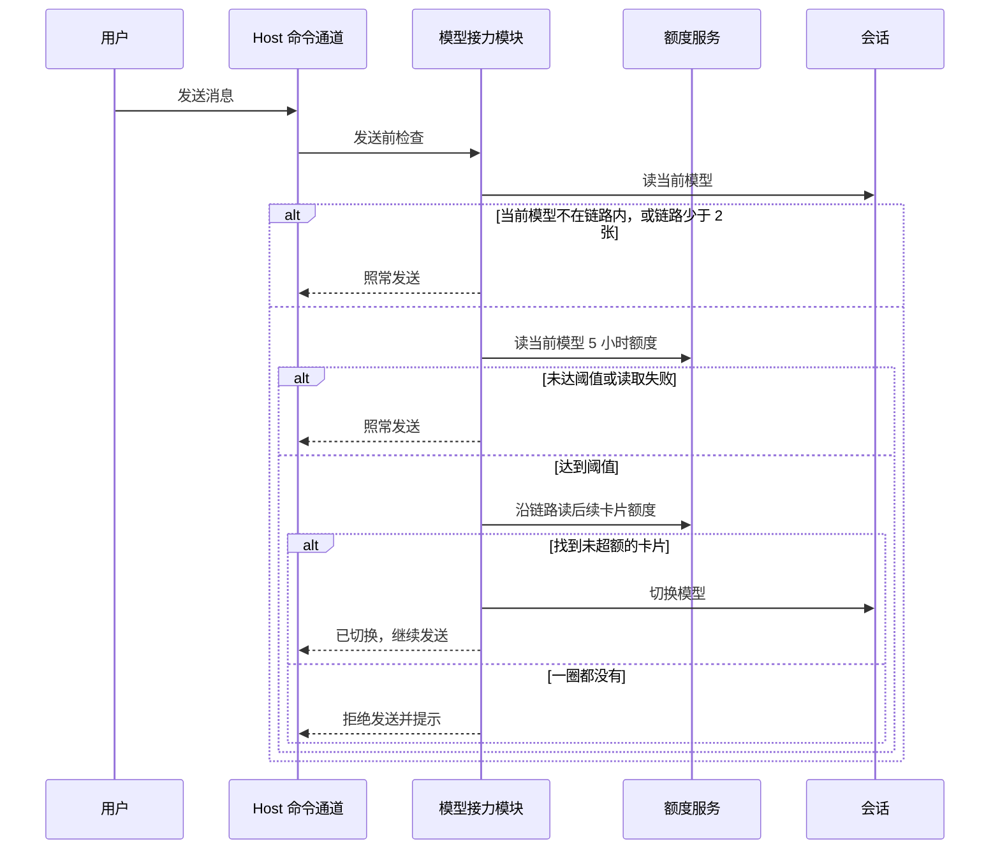
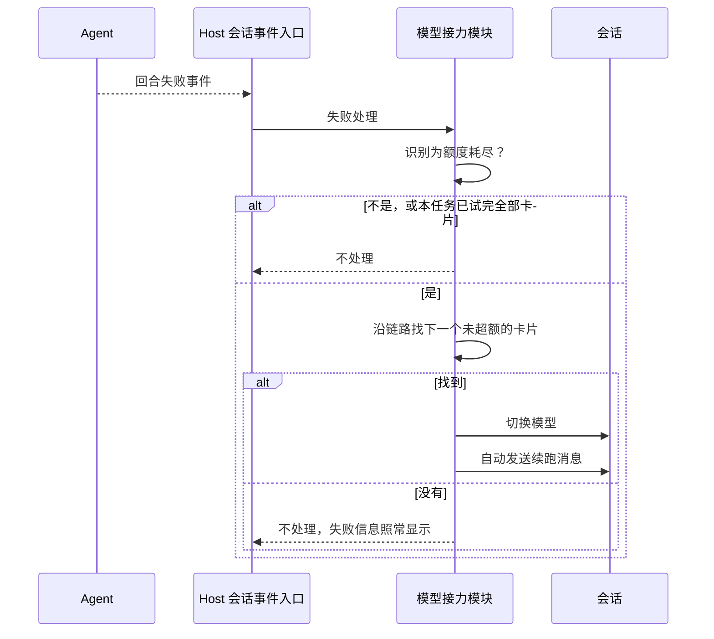

# 模型接力

> 规定模型额度达到阈值后自动切换模型的规则、所有者与验收。切换顺序、环形链路、阈值滑动条由用户配置。上游同步流程见根 `AGENTS.md`；本功能与上游的行为差异同样登记在 [behavior-deltas.md](./behavior-deltas.md)。

## 背景

Coding Plan 类供应商按 5 小时窗口计算额度。一个任务跑到一半额度耗尽会失败停下，需要手动换模型再重发。模型接力在额度到达阈值时自动沿用户配置的模型链路切换，并保留任务已完成的进度继续执行。

## 产品规则

### 配置

- 设置里新增「模型接力」页。卡片从上到下排列，**拖拽后的顺序就是接力顺序**；尾首相接成环。
- 每张卡片是一个模型（供应商 + 模型 ID）加一条「已用额度阈值」滑动条：0–100%，步长 1%，默认 80%。
- 只允许带可识别 5 小时额度数据的模型加入链路；周窗口与按量付费模型不纳入本版本。
- 不加总开关；**链路少于 2 张卡片时整体不生效**。100% 也是合法阈值，不代表关闭。
- 添加、删除、排序、阈值调整立即生效，不需要重启。

### 判定口径

- v1 只看 5 小时窗口。所有供应商的额度归一为 `UsageQuotaLimit`，GLM 系为 `type === "TIME_LIMIT"`（套餐级共享桶），MiniMax 为 `type === "TOKENS_LIMIT"` 且 `unit === 3`、`number === 5`（按模型分桶）。其他类型不参与判定。
- 「达到阈值」= 已用占比 ≥ 该卡片阈值。
- **共用额度不等于共用阈值**：同一套餐共享额度桶的模型仍按各自卡片的阈值判定。
- **查不到额度不等于额度用完**：额度读取失败或没有该模型数据的候选不自动选中，也不被算成「全部超限」。

### 触发时机

1. **发送前检查**：用户发送新一轮之前。仅当会话当前模型在链路内、且已用额度达到自身阈值时，沿卡片顺序找第一个低于自身阈值的卡片，切换后再发送。找不到则拦下发送并提示。
2. **报错续跑**：一轮任务以明确的「额度耗尽」失败之后。按同一规则找下一个可用模型，切换后自动发一条续跑消息，保留该轮已完成的工作，不重做。
3. 已入队的输入可能已冻结模型，不做发送前检查，由报错续跑兜底。
4. 正在执行的模型请求不被强行打断；切换只影响之后的选择。

### 环形与防打转

- 从当前卡片的下一张开始沿顺序检查，最后一张之后回到第一张。
- 同一次任务内每张卡片最多尝试一次；续跑再次失败继续往下找，一圈全部试过即停，不反复切换。

### 一圈全部超限

- 发送前触发：拦下发送，输入框提示「链路中的模型额度都已达到阈值」。
- 报错后触发：不再动作，失败信息照常显示。

### 切换之后

- 会话与界面都保持在新模型，不自动切回。
- 思考强度沿用会话当前档位；目标模型不支持时用目标模型的默认档位。

### 不触发的情况

- 当前模型不在链路内；链路少于 2 张。
- 当前模型额度读取失败（此时不判定、不切换、照常发送）。
- 普通限流、网络错误、用户主动取消不触发报错续跑；只有明确的额度耗尽类失败才触发。

## 所有者与接口

**Host 里新增的模型接力模块是链路配置、额度读取与切换决策的唯一所有者。** 界面只读写配置；CLI Runtime 保有会话模型与队列的最终状态，本轮不改 Agent 运行时，切换与续跑都走既有命令。

| 职责                                                 | 位置                                                  |
| ---------------------------------------------------- | ----------------------------------------------------- |
| 链路结构校验、5 小时桶识别、接力目标决策、额度耗尽码 | `packages/shared/src/model-relay.ts`（纯函数，无 IO） |
| 额度读取、两个触发入口、任务内已尝试记录、切换与续跑 | `packages/services/src/model-relay/`（R2）            |
| 配置页                                               | `packages/ui/src/settings/model-relay/`（R3）         |

### 并发与时序

- 同一会话的发送前检查与切换串行执行；切换走既有的会话模型配置临界区，不与界面手动切换交错。
- 自动决策在执行前校验会话状态仍是决策时的状态：额度查询期间用户手动换模型、停止任务、或出现更新的执行时，迟到的决策作废，不覆盖用户操作、不重复续跑。
- 同一个失败事件只处理一次，不重复触发续跑。

## 不变量

- 纯函数层（shared）不做任何 IO，不依赖产品身份。
- 额度读取失败不影响发送：所有候选额度都未知时结果只能是「保持」。
- 同一条失败事件不会被处理两次；同一任务内同一卡片不会被尝试两次。

## 验收

- 环形：从中间卡片出发能绕回第一张；从最后一张出发能回到开头。
- 跳过规则：共享桶超额的候选被跳过；额度未知的候选被跳过且不算「全部超限」。
- 全部超限：所有已知额度都达阈值时返回「停」；全部未知时返回「保持」。
- 阈值边界：已用占比等于阈值视为达到。
- 额度耗尽判定：CLI 侧 `WORKFLOW_QUOTA_PROVIDER_CODES` 与 shared 侧清单逐项一致（守护用例），上游增减业务码时测试失败。
- 实机（R4）：配置页增删排序、阈值调低后自动切换、全链超限被拦下、报错续跑保留进度。

## 验证记录

### 2026-11-28 检查点 R1（macOS，改动停留在工作区）

- `packages/shared/test/modelRelay.test.ts` 18 项通过：链路校验（重复模型、阈值越界）、两种 5 小时桶识别与周窗口排除、占比缺失视为未知、环形接力、跳过超额与未知候选、全部超限、阈值边界（等于阈值视为达到）、额度耗尽码判定、与 CLI `WORKFLOW_QUOTA_PROVIDER_CODES` 的同源守护（直接读 CLI 源码清单块逐项比对）。
- 决策澄清（已含测试）：当前模型已知超额、其余候选额度未知（如接口故障）→ `exhausted` 停下；当前模型额度未知 → 不判定照常发送。
- 报错续跑的额度码匹配改为包含匹配：业务码常嵌在失败消息原文里（如 `[1308] …重置`）。
- 测试运行前已将 `ZCODE_DATA_BASE_DIR` 换成临时目录（见根 AGENTS.md 二开约定），未触碰真实数据根。
- `pnpm test:engineering` 该文件 18/18；shared 包 `tsc --noEmit` 通过；`pnpm lint` 0 错误、1462 条警告与改动前一致；`pnpm architecture:check --changed` 0 违规；改动文件 `oxfmt --check` 通过。
- 登记：`architecture-policy.yaml` 新增 `fenjue-model-relay-new-file`；`scripts/engineering-test-files.json` 登记新测试。
- 未验证：实机（等 R2/R3 完成后整包安装）。

### 2026-11-28 检查点 R3（macOS，改动停留在工作区）

- 设置页落地：`packages/ui/src/settings/model-relay/` 四个新文件（分区组件、卡片、渐变滑动条、候选查询 hook）；设置项 `modelRelayChain` 进入 `protocol.ts` 与 `validationAppSettings.ts`（object + patch 两个 schema，复用 shared 的 `modelRelayChainSchema`）；导航新增「模型接力」分区（basics 组、模型供应商之后）；5 个语言包各 15 条文案。
- 滑动条复用 `composer-thought-slider.css` 的轨道/渐变/滑块类，取值改 0–100 连续（步长 1），不改动 `ComposerModelMenu`；渐变全程点亮（`data-max` 常置）。
- 候选查询：逐供应商 `getEntitlementSnapshot({ preferredProviderId, requirePreferredProvider: true })`，`readFiveHourUsedPercent` 过滤——只有读得到 5 小时额度的供应商的模型可加入；模块级 30s TTL 缓存；已在链路中的模型不重复出现。
- 浏览器验收 `model-relay.test.mjs` 1/1 通过（真实 Chrome）：初始渲染与顺序、指针拖拽换位（closestCenter 需越过目标卡片底缘才翻转，用 `target.bottom + 24px`）并落盘、阈值滑动到 30% 写入、删除后出现「少于 2 张不生效」提示、添加对话框按额度过滤（已删模型可再加）并写入默认阈值 80%。fixture 经 vite load 钩子替换三个 hook；两个教训已固化在 stub 注释里：stub 后缀必须用真实 `.ts/.tsx`；stub 返回的服务引用必须跨渲染稳定，否则候选查询的 effect 无限重跑。
- `pnpm lint` 0 错误、1462 条警告与改动前一致（全仓明细 diff 过，唯一新增是测试文件未用变量，已删）；`packages/ui` `tsc --noEmit` 通过；`pnpm architecture:check --changed` 0 违规；`architecture-policy.yaml` 登记 `fenjue-model-relay-settings-new-files`。
- 未验证：实机（等 R2 完成后整包安装）；Web 端（远控）分区可用性未人工核查。
