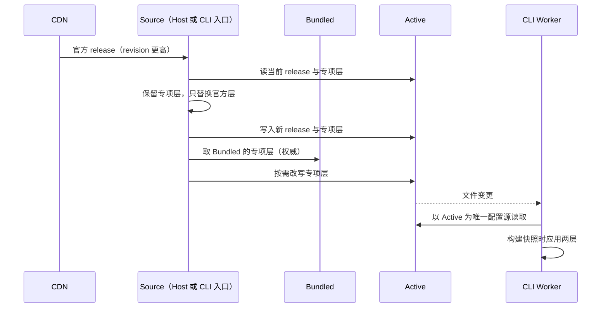

# 内置配置专项层

> 规定 fork 对内置供应商配置（`config/provider/zcode-builtin.json`）的定制方式、声明格式与不变量。上游同步流程见根 `AGENTS.md`「Fen Jue 二开与上游同步」；模型配置专项层的档位规则见 [gpt-reasoning-config-spec.md](../gpt-reasoning-config-spec.md)。

## 背景

内置配置有两个来源：安装包内的 Bundled（当前 revision 44）和 CDN 下发的官方 release（当前 revision 48）。两者取 revision 最高者，所以 Bundled 里官方层的任何改动，在联网后都会被 CDN 的官方 release 覆盖。

已实测的后果：fork 曾把 GPT-6.2 两个模型直接写进 OpenAI 模板的官方列表，联网后运行时快照里并不存在这两个模型。fork 还把 Bundled 的 revision 从 44 改成 45，这会在官方发布 revision 45 时让过期的 Bundled 压住官方 release。

## 产品规则

- 官方 release 决定供应商、模板、模型的官方内容。fork 不直接修改官方层，不改动 `revision`。
- fork 的定制只通过两层**包内专项层**表达。两层都只信任当前安装包的 Bundled，CDN 刷新不能替换它们。
  - `modelConfigOverrides`：模型配置规则（推理档位等）。在所选官方 release 的全部模型规则之后、个人配置之前应用，后写覆盖先写。
  - `providerConfigOverrides`：模板模型插入。按 `templateId` 向该模板的 `builtinModelIds` 插入模型 ID，`at` 取 `start` 或 `end`（默认 `end`）。官方已有的 ID 不重复；官方列表之后新增或删除模型照常跟随。
- 两层的内容指纹进入快照 `revision`，安装包改了声明，派生缓存就会失效。
- 换回不带专项层的包时，专项层自动消失，不继承前一安装包的覆盖。

## 声明格式

两层都声明在唯一来源文件 `config/provider/zcode-builtin.fenjue-overrides.json`，不直接手改 `zcode-builtin.json`：

```json
{
  "modelConfigOverrides": {
    "modelRules": [],
    "modelApiRules": [],
    "providerSiteRules": [],
    "templateModelRules": [],
    "builtinProviderModelRules": []
  },
  "providerConfigOverrides": {
    "templateRules": [
      { "templateId": "openai", "builtinModelIds": ["gpt-6.2-astra", "gpt-6.2-sol"], "at": "start" }
    ]
  }
}
```

校验规则：`templateId` 不能重复；同一规则的 `builtinModelIds` 不能重复且不能为空；`at` 只能是 `start` 或 `end`。

写入与校验由 `scripts/fenjue/builtin-overrides.mjs` 负责：`write` 把两层写入 `zcode-builtin.json` 末尾，`check` 发现两者不一致时退出码为 1。写入按文本插入，不重新序列化整个文件，保证除两个专项层块外与上游逐字节一致。

## 所有者与接口

| 职责                                                               | 位置                                                                 |
| ------------------------------------------------------------------ | -------------------------------------------------------------------- |
| 两层块的严格校验与编解码                                           | `packages/provider-node/src/zcode-builtin-release.ts`                |
| 取 Bundled 的专项层、物化到 Active、远端刷新时保留、构建快照时应用 | `packages/provider-node/src/zcode-builtin-provider-config-source.ts` |
| 声明的写入与漂移校验                                               | `scripts/fenjue/builtin-overrides.mjs`                               |

两层都在构建快照时应用（`snapshotFromRelease`）：模型层合并进 `models`，模板层应用到 `providerTemplates`。合并结果不写回 Active 的官方列表，Active 里官方层保持官方原样、另存两块专项层。



Bundled 不可读时回退到选中 release 自带的专项层，不把专项层整块擦掉；Bundled 可读但不带专项层时仍是权威，旧包不继承前一安装包的覆盖。

## 不变量

- Active 的 `revision` 等于所选官方 release 的 `revision`，专项层不参与版本比较。
- 同一份 release 加同一份专项层，序列化结果稳定；相同 revision 重复刷新返回 `unchanged`。
- 模板层只增不改：对同一官方列表重复应用是幂等的。
- 快照里的 `providerTemplates` 与 `models` 是应用专项层之后的结果；Active 文件里的官方层不含专项层内容。

## 为什么不用其他做法

- **不虚增 revision**：`selectReleaseCandidate` 在同 revision、内容不同时取 Bundled，`applyRemoteRelease` 在同 revision、内容不同时抛错。官方 revision 一旦追平虚增值，过期的 Bundled 就会压住官方 release。
- **不把合并结果写进 Active 的官方列表**：那样虽然能兼容旧 CLI，但 fork 以后移除某个模型时，已安装用户要等下一次官方 release 才会消失，违背「无专项层的包不继承前一安装包的覆盖」。
- **不拆成运行时读取的独立文件**：CLI 入口用自己 Bundled 里的专项层重写 Active。独立文件只有 Host 读得到，Host 与 CLI 会互相覆盖。

## 已知影响

Active 的 schema 多了 `providerConfigOverrides`。旧版 CLI 读到它会把它当作无效缓存、改写回自己 Bundled 的版本，Host 再改回来，两边互相覆盖。**本次起 Host 与 CLI 必须同包升级，不能只替换 `app.asar`。**

## 验收

- Active 为 revision 48、49、50 时，OpenAI 模板的模型列表都含 fork 声明的模型，官方新增的模型不丢；Host 与 Worker 读取结果一致；相同 revision 重复刷新幂等。
- 换回不带专项层的包后，fork 声明的模型消失，官方列表完好。
- 只改模板层声明、不改模型层声明时，快照 `revision` 仍然变化。
- Bundled 的 `revision` 与上游一致；OpenAI 模板的官方列表与上游一致。
- 声明不合法（`templateId` 重复、ID 重复、`at` 非法）时整份 release 解码失败。
- 对真实 CDN Active（revision 48）用生产代码读取，快照含 `gpt-6.2-sol` 与 GPT-6.2 五档规则。

## 验证记录

### 2026-11-28 检查点 B（macOS，改动停留在工作区，未安装）

- `config/provider/zcode-builtin.json` 相对上游：0 行删除、250 行纯追加。`revision` 回到 44，OpenAI 模板的官方列表与上游逐项一致。
- 生产解码器：编解码往返稳定；五类非法的模板专项层声明（`templateId` 重复、ID 重复、`at` 非法、ID 为空、未知字段）都被整份 release 拒绝。
- 真实 CDN Active（revision 48）的副本经生产 `Source.read()`：OpenAI 模板 15 个模型，前两个是 GPT-6.2；`gpt-6.2-sol` 五档；587 条模型规则；物化后的 Active 里官方列表不含 GPT-6.2，两块专项层另存。验证在副本上进行，真实 Active 文件未被触碰。
- bootstrap 包 `zcode-builtin-model-runtime-integration.test.ts` 12 项（新增 7 项）、`process-provider-builtin-refresh-cadence.test.ts` 8 项通过；adapters 包 `model-option-map-fetch.test.ts` 40 项通过。
- 浏览器验收 `gpt-reasoning.test.mjs` 两项通过（1200 宽中文深色 Responses、390 宽英文浅色 Chat Completions）。
- `pnpm typecheck` 通过；bootstrap、provider-node 两个包 `tsc --noEmit` 通过。
- `pnpm lint` 0 错误，1462 条警告与改动前一致；`pnpm architecture:check --changed` 0 违规；改动文件 `oxfmt --check` 通过。
- 未验证：整包安装后的实机效果；Windows 构建。唯一来源文件与生成脚本在检查点 C 交付，本步的 JSON 由一次性脚本写入。

### 2026-11-28 实机安装（macOS）

- 新版 Host 启动后重写了 Active：revision 48，`config` 含两块专项层，OpenAI 官方列表不含 GPT-6.2。Active 只在启动时被写过一次，没有出现新旧版本互相覆盖。
- 交付给 Agent 的配置版本第 4 段指纹由 `9e5ac038…` 变为 `6b4892cf…`（两层专项层的指纹），与 Host 侧读取结果一致。
- 用生产代码读取运行中应用的真实配置：OpenAI 模板 15 个模型，前两个是 GPT-6.2；`gpt-6.2-sol` 五档。读取没有改动 Active 文件。
- 未验证：设置页与模型选择器里的 OpenAI 模板模型列表（应用不是带调试端口启动的）；Windows 构建。
