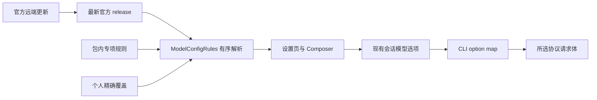

# GPT 推理等级智能配置

## 产品规则

2026-11-27：模型能力由 `config/provider/zcode-builtin.json` 的有序规则唯一持有。
设置页编辑器和 Composer 读取同一个解析结果，不新增 UI 专属 GPT 判断或持久化字段。

| 模型                                          | 从低到高的等级                      |
| --------------------------------------------- | ----------------------------------- |
| GPT-6.2 Sol / Astra、GPT-6.1 Sol、GPT-6 Astra | low、medium、high、xhigh、max       |
| GPT-6 Sol / Luna、GPT-6.1 Terra、GPT-5.6 系列 | none、low、medium、high、xhigh、max |
| GPT-5.2、GPT-5.4、GPT-5.5                     | none、low、medium、high、xhigh      |
| GPT-5.1                                       | none、low、medium、high             |
| GPT-5 / mini / nano                           | minimal、low、medium、high          |

保留现有 GPT-5.4 Pro、5.3 Codex 等更具体规则；不将未知 GPT 后缀推断为已知型号。
已知模型在自定义供应商中也能识别，包括 `openai/` 命名空间、大小写和日期快照。
未知模型继续使用原有通用配置。`pro` 是独立推理模式，不作为 effort；不添加没有 API 依据的 ultra。

## 接口和配置优先级

Responses 仅映射 `reasoning.effort`，Chat Completions 仅映射 `reasoning_effort`。
已知 GPT 的 OpenAI 协议请求不能混入通用兼容映射的 `thinking`、`enable_thinking`。
Anthropic Messages 及供应商专有协议继续使用原协议规则，不强行改为 OpenAI 请求体。
常规模型等级规则先于协议映射，随后应用站点和模板规则。
`config.modelConfigOverrides` 是包内明确声明的专项模型规则层，在所选官方 release 的全部模型规则之后、个人配置之前应用；只覆盖该层显式声明的字段。
手动档位、参数映射和个人模型配置不得被自动升级覆写；已有显式覆盖需要在设置页主动重置才能采用新推荐。
官方 release 仍按 bundled / active 的 revision 选择最新版本，不通过虚增版本压过 CDN。
专项层只能由当前安装包的 bundled release 决定，远端提供同名字段不能替换它。Host 将所选官方配置与专项层原子物化到 Active，CLI Worker 读取同一文件，重启后仍保留；无专项层的包维持原行为。
专项层的内容指纹进入发布快照 revision，使官方版本未变而安装包专项规则变化时也能使派生缓存失效。

已确认旧包失败根因：包内 revision 45 被用户运行目录中的官方 revision 48 选中覆盖；旧隔离用例只读取 bundled，未模拟更高版本 Active。新增验收必须从真实 Source 读写隔离 Active 并经过 Worker 重读，不能只合并 JSON 验证。

## 验收

- 隔离浏览器编辑 GPT-6.2 Sol，显示五个合法档位，保存不产生冗余个人覆盖。
- 切换不同 GPT 型号，得到对应档位；手动修改后刷新推荐仍保留显式编辑。
- CLI 从真实内置 JSON 解析规则，逐档捕获 Chat / Responses 最终请求体，确认参数名、值和输出预算。
- 覆盖原有具体模型规则、命名空间、快照、未知模型和个人覆盖；保留 Anthropic 协议映射。
- 模拟 revision 48/49/50 的官方更新与旧模板覆盖：专项 GPT 档位和映射保留，其他模型更新正常生效；重新启动 Source 和 Worker 从 Active 读取后结果一致；同版本刷新不产生冲突或规则膨胀。
- 不访问真实用户配置，不调用收费模型接口。执行 typecheck、lint、架构门禁。

## 依据

- [推理模型](https://developers.openai.com/api/docs/guides/reasoning)：等级与协议字段、GPT-6.2 不支持 none。
- [部署检查](https://developers.openai.com/api/docs/guides/deployment-checklist)：GPT-6.2、6.1 Terra、6 Luna 档位。
- [GPT-6 Sol](https://developers.openai.com/api/docs/models/gpt-6-sol)、[GPT-5.5](https://developers.openai.com/api/docs/models/gpt-5.5)、[GPT-5.2](https://developers.openai.com/api/docs/models/gpt-5.2)、[GPT-5.1](https://developers.openai.com/api/docs/guides/latest-model?model=gpt-5.1)、[GPT-5](https://developers.openai.com/api/docs/models/gpt-5)。

## 本次验证记录

2026-11-27 Windows：CLI `model-option-map-fetch.test.ts` 共 40 项通过，逐档捕获最终 transport 请求体；隔离浏览器 `gpt-reasoning.test.mjs` 两项通过，覆盖 1200px 中文深色 Responses 与 390px 英文浅色 Chat Completions、推荐值保存和手动覆盖保留。
完整 `pnpm typecheck` 通过；`pnpm lint` 为 0 错误、538 条存量警告，本次文件没有新增相关诊断；架构检查 0 违规。根目录与 CLI 各自的格式检查通过。
未执行真实收费 API 请求、真实账号配置迁移或安装包更新。

### 远端覆盖修复验证

CLI 请求回归 40 项、完整模型运行时集成 4 项、浏览器两项通过。新增 Source 集成用例复现更高版本 Active 和陈旧模板覆盖，检查连续官方刷新、同版本幂等、无关模型更新、Host 重启、Worker 重读、无专项层的旧包回退；浏览器用例改为从真实 Source 加载 revision 48 的隔离 Active。类型检查、架构检查通过，完整 lint 为 0 错误、538 条存量警告。Agent CLI 已重新编译并检查包含新信封字段，不复用旧 Worker。
