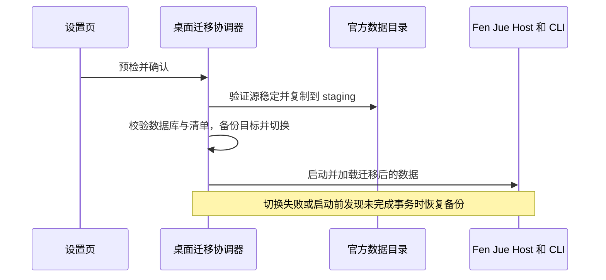

# 从官方 ZCode 导入本机数据

## 产品规则

Fen Jue 桌面设置提供「从官方 ZCode 迁移数据」。先只读检查来源、版本、容量和目标现有数据，列出可迁移、需重新登录及跳过的类别，再确认执行。Web、手机远控和远程工作区不提供该操作。

采用整套导入并保留原目标备份。目标已有内容时，明确提示生效后将显示官方版的数据，原 Fen Jue 数据可恢复。恢复也在重启阶段执行，并保留恢复前的数据副本。

## 数据边界

首版来源为用户主目录的 `~/.zcode`，目标为 Fen Jue 默认数据根。自定义数据根暂不支持，入口会拦截。拒绝来源和目标相同、互相包含或指向同一物理位置。官方目录全程只读。

按存储所有者确认清单：设置、任务和工作区索引、CLI 会话库及关联文件、用户技能与配置、插件状态。项目原文件保留在原路径。缓存、日志、临时文件、随包运行组件和 Electron 浏览器配置不参与导入。系统凭据和账号按现有密钥存储接口评估兼容性，无法安全恢复时提示重新登录；不得记录密钥或令牌。检查设置中的旧数据根、绝对路径、自动化与信任记录，避免重启后回连官方目录或擅自启动任务。

迁移清单接受有效目录链接和文件链接，复制链接自身。指向官方数据根内部的链接重定位到 Fen Jue 数据根内的对应位置，外部链接继续引用原外部位置。Windows 目录链接以 junction 创建，避免依赖符号链接提权。已失效链接不包含可读数据，跳过并在迁移完成时报告数量。文件链接无法创建时，在目录切换前报错并保留原数据。

## 状态所有者与接口

设置页通过 hook 调用桌面平台接口，提供预检、确认和迁移结果。桌面协调器持有唯一迁移事务和锁，业务存储继续由现有 Host 与 CLI 管理。确认后在重启阶段执行，要求来源实例及相关 CLI 不再写入；目标 Host 和 CLI 在切换完成前不启动。



SQLite 通过一致快照或确认无写入后的完整库组复制，不能只复制主文件并丢弃 WAL。提交前检查版本、库完整性和清单。使用目标同卷 staging 与持久事务标记，保证进程中断后可恢复。重复确认复用同一事务，不重复导入。

默认数据根的备份位于旁边的 `.zcode-official-import/backup`。恢复时将当前数据移至同目录下的 `before-restore-<id>`。已有待恢复备份时，先恢复才能再次导入。导入的任务索引中，定时自动化默认停用，需要用户在 Fen Jue 重新启用。

## 验收

- 使用隔离的模拟官方和 Fen Jue 数据根，从桌面设置发起。迁移后可打开历史会话、任务和工作区，用户配置可加载，官方源文件哈希保持一致。
- 覆盖已有目标备份及恢复、源正在写入、源版本不支持、空间不足、路径冲突和切换中断。
- 验证无法携带的凭据有重新登录提示，应用继续使用自己的数据根，手机远控看不到入口。

## 追记 2026-11-27：预估与进度 UX

用户反馈原交互「确认并重启 → 静默迁移」过于潦草。改为四段式：

```text
用户点击迁移
  → Main 调 estimate()（只读遍历官方源，排除规则同迁移）
  → 原生确认框展示「待迁移 N 个文件 · X GB」
  → 确认后仍走 schedule + quit + relaunch（迁移必须在启动早期、服务未开 SQLite 前交换目录）
  → 重启后 whenReady 检测 pending → 先开专用进度窗口（独立 html + preload，主窗口/服务未就绪）
  → run(onProgress) 推 copy/verify/swap/done 四阶段（文件数 + 字节数），节流落盘 progress.json
  → 成功：窗口切完成态，「重启应用」按钮 relaunch 冷启跑在迁移后的数据上
  → 失败（run 内部已回滚、pending 已清）：窗口切失败态 + 错误码，「退出」非零退出
窗口创建失败回退旧路径（静默迁移 + 同步弹窗）。恢复备份走同一进度窗口。
```

进度窗口与 main 的通道：`zcode:official-data-import-progress / finished / failed`（Main → 窗口）、
`zcode:official-data-import-restart / quit`（窗口 → Main）。preload 只暴露这五个方法。

验收补充：

- estimate 与迁移共用同一排除规则（roots 白名单 + excluded 正则），确认框数字与实际迁移条目一致。
- 进度窗口在迁移全程可见；完成后必须由用户点击「重启应用」，不得无提示静默进入主界面。
- 单测覆盖 estimate 计数/字节/排除/per-root 聚合、run 阶段顺序与失败回滚（officialDataImportEstimateProgress.test.ts）。
